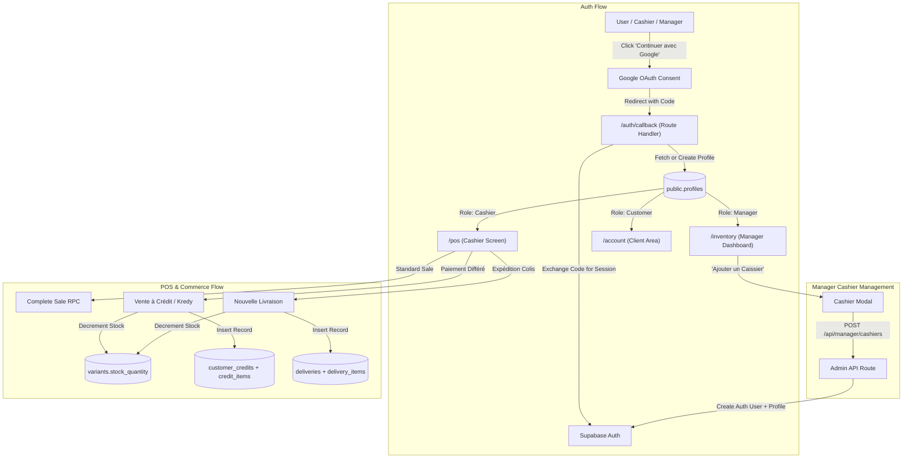

# Plan & Checklist — Google OAuth, Cashier Management, Credit Ledger & Delivery System

> **Status**: 📋 PLAN MODE ONLY — Awaiting User Approval (Do NOT implement yet)  
> **Target Project**: Top Tendance (Next.js 14 App Router, Supabase, Tailwind CSS, Tunisian Dinar `TND`)  
> **Date**: 2026-11-11  

---

## 🎯 Scope Overview

This project evolution covers three major functional areas requested by the business:
1. **Universal Google OAuth Authentication**:
   - Google Sign-In for all 3 user roles: Customers, Cashiers, and Managers.
   - Automatic profile creation/synchronization with role-based routing (`/account`, `/pos`, `/inventory`).
2. **Manager Dashboard — Cashier Team Management**:
   - Manager can view, invite, create, and manage Cashiers directly from the dashboard.
   - Secure backend API endpoint with manager-only authorization and Supabase Admin integration.
3. **Credit Ledger & Delivery Management**:
   - **Carnet de Crédit (Customer Credit / Paiement Différé / Kredy)**: When someone takes an item and pays later. Tracks customer name, phone number, specific items taken, total amount, initial deposit (acompte), remaining balance, and partial payments history. Automatically decrements inventory upon credit departure.
   - **Delivery System (Gestion des Livraisons & Expéditions)**: Shipping items with Cash on Delivery (COD) or pre-payment. Tracks courier, tracking number, customer phone, address, governorate, status lifecycle, and stock movements.

---

## 📐 System Architecture & Workflow Diagram



---

## 📋 Comprehensive Implementation Checklist

---

### PHASE 1: Google OAuth Authentication for All Roles

- [x] **1.1 Supabase & Google Cloud Configuration**
  - [x] Configure Google Cloud Console:
    - [x] Create OAuth 2.0 Web Client credentials.
    - [x] Set Authorized Redirect URI: `https://uqwvbbuxriiduedhdqwl.supabase.co/auth/v1/callback`.
  - [x] Configure Supabase Authentication:
    - [x] Enable Google Provider under Supabase Dashboard -> Authentication -> Providers -> Google.
    - [x] Input Google Client ID & Google Client Secret.
    - [x] Add Redirect URLs in Supabase URL Configuration:
      - `https://toptendance.net/auth/callback`
      - `http://localhost:3000/auth/callback`
  - [x] Update `profiles` table check constraint to support all roles (`customer`, `cashier`, `manager`):
    ```sql
    ALTER TABLE public.profiles DROP CONSTRAINT IF EXISTS profiles_role_check;
    ALTER TABLE public.profiles ADD CONSTRAINT profiles_role_check CHECK (role IN ('customer', 'cashier', 'manager'));
    ```

- [x] **1.2 Database Profile Auto-Sync Trigger**
  - [x] Create a robust PostgreSQL trigger on `auth.users` on `INSERT`:
    - Automatically create a `public.profiles` row if none exists yet.
    - Default `role` to `'customer'` for organic public registrations.
    - Extract `full_name` from Google OAuth metadata (`raw_user_meta_data->>'full_name'` or `raw_user_meta_data->>'name'`).
    - If user was pre-registered as `cashier` or `manager` by email, preserve their elevated role!

- [x] **1.3 Next.js Auth Callback Route Handler (`src/app/auth/callback/route.ts`)**
  - [x] Create `src/app/auth/callback/route.ts` using `@supabase/ssr`:
    - [x] Extract `code` and optional `next` or `redirectTo` parameter from request URL.
    - [x] Exchange `code` for a session: `supabase.auth.exchangeCodeForSession(code)`.
    - [x] Retrieve authenticated user ID and query `public.profiles` for `role`.
    - [x] Role-based intelligent redirect:
      - `manager` $\rightarrow$ `/inventory`
      - `cashier` $\rightarrow$ `/pos`
      - `customer` $\rightarrow$ `next` parameter (if valid internal route) or `/account`.
    - [x] Error fallback: If exchange fails, redirect to `/login?error=oauth_failed`.

- [x] **1.4 UI Integration on Login & Register Screens**
  - [x] Update `src/app/login/page.tsx`:
    - [x] Add high-contrast, stylish "Continuer avec Google" button with official Google SVG icon.
    - [x] Implement `handleGoogleLogin()` invoking `supabase.auth.signInWithOAuth({ provider: 'google', options: { redirectTo: ... } })`.
    - [x] Retain existing email/password login as fallback.
  - [x] Update `src/app/register/page.tsx`:
    - [x] Add "S'inscrire avec Google" button.
    - [x] Display subtle separator (`── ou avec votre email ──`).

---

### PHASE 2: Manager Dashboard — Cashier Team Management

- [x] **2.1 Server-Side Cashier Management API (`/api/manager/cashiers`)**
  - [x] Create `src/app/api/manager/cashiers/route.ts`:
    - [x] **Security verification**:
      - Read session cookies via `createServerClient` (`@supabase/ssr`).
      - Verify caller identity with `supabase.auth.getUser()`.
      - Query `public.profiles` to strictly assert `role === 'manager'`. Deny with 403 Forbidden if not a manager.
    - [x] **GET Handler**:
      - Returns list of cashiers (`id`, `full_name`, `phone`, `email`, `created_at`, `last_sign_in_at`).
    - [x] **POST Handler (Add Cashier)**:
      - Validate payload: `fullName`, `email`, `phone`, `password`.
      - Use Supabase Admin Client (`SUPABASE_SERVICE_ROLE_KEY`):
        - Call `supabaseAdmin.auth.admin.createUser({ email, password, email_confirm: true, user_metadata: { full_name: fullName, phone } })`.
        - Upsert into `public.profiles` with `role = 'cashier'`, `full_name = fullName`, `phone = phone`.
      - Return newly created cashier record (omitting sensitive auth tokens).
    - [x] **DELETE / PATCH Handlers**:
      - Allow manager to deactivate/delete cashier or reset their credentials.

- [x] **2.2 Environment Variables Configuration**
  - [x] Ensure `SUPABASE_SERVICE_ROLE_KEY` is documented and added to `.env.local` / production environment for secure server-side admin user creation.

- [x] **2.3 Manager Dashboard UI for Cashier Management**
  - [x] Create dedicated "Équipe & Caissiers" tab or sub-page in Manager area:
    - [x] Header metric counters: Total Caissiers actifs, Caissiers en service.
    - [x] Searchable & filterable Cashier table (Nom, Email, Téléphone, Date d'ajout, Statut).
    - [x] "Nouveau Caissier" button opening a clean modal dialog:
      - Fields: Nom complet, Email (Google ou pro), Numéro de téléphone (Tunisie +216), Mot de passe temporaire.
      - Option: "Générer un mot de passe sécurisé" button.
      - Note: "Si le caissier utilise son adresse Google, il pourra également se connecter en 1 clic avec Google".
    - [x] Delete / Deactivate confirmation modal.

---

### PHASE 3: Credit Ledger ("Carnet de Crédit / Kredy / Vente à Terme")

- [x] **3.1 Database Schema for Customer Credits**
  - [x] Create `customer_credits` table:
    ```sql
    CREATE TABLE IF NOT EXISTS public.customer_credits (
        id UUID PRIMARY KEY DEFAULT gen_random_uuid(),
        customer_name TEXT NOT NULL,
        customer_phone TEXT NOT NULL,
        customer_address TEXT,
        customer_cin TEXT,
        total_amount NUMERIC(12, 3) NOT NULL CHECK (total_amount >= 0),
        deposit_amount NUMERIC(12, 3) NOT NULL DEFAULT 0.000 CHECK (deposit_amount >= 0),
        remaining_balance NUMERIC(12, 3) NOT NULL CHECK (remaining_balance >= 0),
        status TEXT NOT NULL CHECK (status IN ('pending', 'partially_paid', 'settled', 'cancelled')),
        due_date DATE,
        notes TEXT,
        cashier_id UUID REFERENCES public.profiles(id) ON DELETE SET NULL,
        created_at TIMESTAMPTZ NOT NULL DEFAULT timezone('utc'::text, now()),
        updated_at TIMESTAMPTZ NOT NULL DEFAULT timezone('utc'::text, now())
    );
    CREATE INDEX idx_credits_phone ON public.customer_credits(customer_phone);
    CREATE INDEX idx_credits_status ON public.customer_credits(status);
    ```
  - [x] Create `credit_items` table (captures items taken on credit):
    ```sql
    CREATE TABLE IF NOT EXISTS public.credit_items (
        id UUID PRIMARY KEY DEFAULT gen_random_uuid(),
        credit_id UUID NOT NULL REFERENCES public.customer_credits(id) ON DELETE CASCADE,
        variant_id UUID NOT NULL REFERENCES public.variants(id) ON DELETE RESTRICT,
        product_name TEXT NOT NULL,
        sku TEXT NOT NULL,
        size TEXT,
        color TEXT,
        quantity INT NOT NULL CHECK (quantity > 0),
        unit_price NUMERIC(12, 3) NOT NULL CHECK (unit_price >= 0),
        subtotal NUMERIC(12, 3) NOT NULL CHECK (subtotal >= 0)
    );
    ```
  - [x] Create `credit_payments` table (tracks repayment installments):
    ```sql
    CREATE TABLE IF NOT EXISTS public.credit_payments (
        id UUID PRIMARY KEY DEFAULT gen_random_uuid(),
        credit_id UUID NOT NULL REFERENCES public.customer_credits(id) ON DELETE CASCADE,
        amount NUMERIC(12, 3) NOT NULL CHECK (amount > 0),
        payment_method TEXT NOT NULL CHECK (payment_method IN ('cash', 'card')),
        received_by UUID REFERENCES public.profiles(id) ON DELETE SET NULL,
        notes TEXT,
        created_at TIMESTAMPTZ NOT NULL DEFAULT timezone('utc'::text, now())
    );
    ```

- [x] **3.2 Atomic RPC Function: `create_credit_sale`**
  - [x] Create PostgreSQL function `public.create_credit_sale`:
    - [x] Atomically verify stock availability for each variant.
    - [x] Decrement variant stock (`variants.stock_quantity = stock_quantity - item.quantity`).
    - [x] Log `stock_movements` with `movement_type = 'credit_sale'`.
    - [x] Insert record into `customer_credits`.
    - [x] Insert items into `credit_items`.
    - [x] If initial deposit $> 0$, insert entry into `credit_payments` and link to daily cash register.
    - [x] Return JSON payload with credit ID, customer info, and ticket data.

- [x] **3.3 Atomic RPC Function: `record_credit_payment`**
  - [x] Create PostgreSQL function `public.record_credit_payment`:
    - [x] Atomically insert installment in `credit_payments`.
    - [x] Subtract payment amount from `remaining_balance` in `customer_credits`.
    - [x] Automatically update `status`:
      - If `remaining_balance == 0` $\rightarrow$ `'settled'` (Soldé).
      - Else $\rightarrow$ `'partially_paid'` (Partiellement réglé).

- [x] **3.4 POS Screen Integration (`/pos`)**
  - [x] In `src/components/pos/PaymentDrawer.tsx`:
    - [x] Add payment tab/option: **"Vente à Crédit / Paiement Différé"**.
    - [x] Customer info fields:
      - Nom complet du client (Obligatoire).
      - Numéro de téléphone (Obligatoire, 8 chiffres tunisiens avec validation).
      - Acompte versé aujourd'hui (Optionnel, défaut 0.000 DT).
      - Mode de paiement de l'acompte (Espèces / Carte bancaire).
      - Date d'échéance convenue (Optionnel).
      - Notes / Référence client.
    - [x] Display live summary: Montant total des articles, Acompte immédiat, **Reste à payer plus tard**.
  - [x] Print "Bon de Vente à Crédit / Ticket Débiteur":
    - Formatted ticket with customer name, phone, items list, amount paid today, and remaining balance due with signature line.

- [x] **3.5 Dedicated "Carnet de Crédit" (Credit Ledger) UI**
  - [x] Create screen accessible from both POS and Manager Dashboard:
    - [x] KPI Cards:
      - Total Dettes en cours (Total Outstanding Balance).
      - Total Encaissé ce mois (Total Recovered).
      - Nombre de clients débiteurs.
    - [x] Search bar: Search instantly by customer phone number or customer name.
    - [x] Filter pills: `Tous`, `En cours (Non payé)`, `Partiellement réglé`, `Soldé`.
    - [x] Action "Encaisser un Règlement":
      - Quick payment modal: Enter amount received (e.g. 50 DT of a 120 DT debt), payment method (`Espèces` / `Carte`), cashier notes.
      - Automatically recalculates balance and updates status.
    - [x] Expandable item breakdown drawer showing the exact garments taken (Product name, size, color, unit price).

---

### PHASE 4: Delivery Management ("Gestion des Livraisons & Colis")

- [x] **4.1 Database Schema for Deliveries**
  - [x] Create `deliveries` table:
    ```sql
    CREATE TABLE IF NOT EXISTS public.deliveries (
        id UUID PRIMARY KEY DEFAULT gen_random_uuid(),
        tracking_number TEXT,
        courier_name TEXT NOT NULL DEFAULT 'Aramex', -- Aramex, Yalidine, Express, Livraison Propre
        recipient_name TEXT NOT NULL,
        recipient_phone TEXT NOT NULL,
        recipient_phone_alt TEXT,
        address TEXT NOT NULL,
        city TEXT NOT NULL,
        governorate TEXT NOT NULL, -- 24 gouvernorats tunisiens
        cod_amount NUMERIC(12, 3) NOT NULL DEFAULT 0.000 CHECK (cod_amount >= 0), -- Contre remboursement
        shipping_fee NUMERIC(12, 3) NOT NULL DEFAULT 7.000 CHECK (shipping_fee >= 0),
        status TEXT NOT NULL CHECK (status IN ('preparing', 'dispatched', 'in_transit', 'delivered', 'returned', 'cancelled')),
        payment_status TEXT NOT NULL DEFAULT 'unpaid' CHECK (payment_status IN ('unpaid', 'paid', 'remitted_by_courier')),
        notes TEXT,
        created_by UUID REFERENCES public.profiles(id) ON DELETE SET NULL,
        created_at TIMESTAMPTZ NOT NULL DEFAULT timezone('utc'::text, now()),
        delivered_at TIMESTAMPTZ
    );
    CREATE INDEX idx_deliveries_phone ON public.deliveries(recipient_phone);
    CREATE INDEX idx_deliveries_tracking ON public.deliveries(tracking_number);
    CREATE INDEX idx_deliveries_status ON public.deliveries(status);
    ```
  - [x] Create `delivery_items` table:
    ```sql
    CREATE TABLE IF NOT EXISTS public.delivery_items (
        id UUID PRIMARY KEY DEFAULT gen_random_uuid(),
        delivery_id UUID NOT NULL REFERENCES public.deliveries(id) ON DELETE CASCADE,
        variant_id UUID NOT NULL REFERENCES public.variants(id) ON DELETE RESTRICT,
        product_name TEXT NOT NULL,
        sku TEXT NOT NULL,
        size TEXT,
        color TEXT,
        quantity INT NOT NULL CHECK (quantity > 0),
        unit_price NUMERIC(12, 3) NOT NULL CHECK (unit_price >= 0)
    );
    ```

- [x] **4.2 Stock Management on Shipping & Returns**
  - [x] Create atomic RPC `create_delivery_order`:
    - Decrements `variants.stock_quantity`.
    - Logs `stock_movements` with `movement_type = 'delivery_shipment'`.
  - [x] Create atomic RPC `process_delivery_return`:
    - Restores `variants.stock_quantity` if package is returned/undelivered.
    - Logs `stock_movements` with `movement_type = 'delivery_return'`.

- [x] **4.3 Delivery Management Screen (`/inventory/deliveries` or Delivery Tab)**
  - [x] Pipeline Kanban or filtered list:
    - 📦 `En préparation`
    - 🚚 `Expédié / En cours de route`
    - ✅ `Livré & Encaissé`
    - ↩️ `Retour Colis`
  - [x] "Nouvelle Expédition / Colis" modal:
    - Customer details (Nom, Téléphone, Adresse, Gouvernorat parmi les 24).
    - Sélection des articles (scan code-barres ou sélecteur de variantes).
    - Frais de port (ex: 7.000 DT ou Gratuit) + Total Contre-Remboursement (COD).
    - Choix du transporteur (Aramex, Yalidine, Coursier interne).
  - [x] Imprimer "Bordereau de Livraison / Expédition" (Shipping Slip with Barcode).
  - [x] Quick status update buttons: "Marquer comme Livré & Payé", "Marquer comme Colis Retourné".

---

### PHASE 5: Security, RLS & Testing Verification

- [x] **5.1 Row Level Security (RLS) Policies**
  - [x] Enable RLS on all new tables:
    - `customer_credits`, `credit_items`, `credit_payments`
    - `deliveries`, `delivery_items`
  - [x] Policies:
    - Cashiers and Managers can read, insert, and update credits and deliveries.
    - Regular customers can only read deliveries linked to their phone or user account.
    - Costs and profit margins remain strictly manager-only.

- [ ] **5.2 Testing Scenarios**
  - [ ] **Test Google Auth**:
    - [ ] Sign in with a new Google Account $\rightarrow$ automatically created as customer $\rightarrow$ redirected to `/account`.
    - [ ] Sign in with a Cashier Google Account $\rightarrow$ redirected to `/pos`.
    - [ ] Sign in with a Manager Google Account $\rightarrow$ redirected to `/inventory`.
  - [ ] **Test Add Cashier**:
    - [ ] Manager logs in, opens Cashier Management, adds `cashier_test@toptendance.tn`.
    - [ ] Cashier logs in with those credentials $\rightarrow$ successfully lands on `/pos`, blocked from `/inventory`.
  - [ ] **Test Credit Sale**:
    - [ ] Cashier adds a dress (stock = 15) to cart, chooses "Vente à Crédit".
    - [ ] Enters customer: "Foulen Ben Foulen", phone: "98123456", acompte: 20 DT on 149 DT total.
    - [ ] Completes transaction:
      - Stock drops from 15 to 14.
      - Remaining debt = 129.000 DT with status `'partially_paid'`.
      - Ticket printed with customer debt breakdown.
    - [ ] Open Carnet de Crédit $\rightarrow$ customer found by phone "98123456".
    - [ ] Cashier collects 129.000 DT $\rightarrow$ status changes to `'settled'`.
  - [ ] **Test Delivery Order**:
    - [ ] Create delivery to Sfax, 1 item.
    - [ ] Stock decremented.
    - [ ] Package marked as delivered $\rightarrow$ COD payment recorded.

---

## 📌 Important Prerequisites Before Implementation Starts
1. **Google Cloud Console**: Client ID and Client Secret need to be generated for OAuth 2.0 Web Application.
2. **Supabase Dashboard**: Enable Google Provider and save Google credentials.
3. **Service Role Key**: Ensure `SUPABASE_SERVICE_ROLE_KEY` is available in environment variables for the Manager Cashier Admin API.

