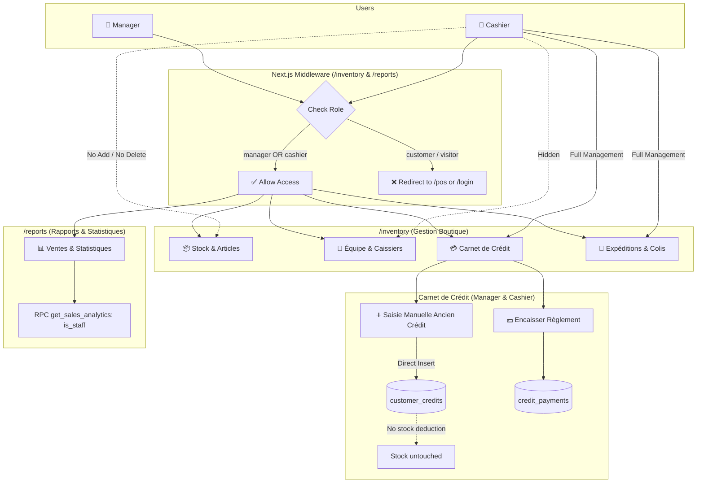

# Plan & Checklist — Cashier Permissions, Boutique/Reports Access & Manual Old Credit Entry

> **Status**: 📋 **PLAN MODE ONLY — Awaiting User Approval (Do NOT implement yet)**  
> **Target Project**: Top Tendance POS & Boutique (Next.js 14 App Router, Supabase, Tailwind CSS, Tunisian Dinar `TND`)  
> **Date**: 2026-11-14  

---

## 📌 Executive Summary

The business requires expanding the cashier's operational scope while maintaining strict controls over sensitive inventory actions and team administration:
1. **Open Credit Ledger & Delivery to Cashier**: The cashier can now fully access and manage customer credits ("Carnet de Crédit") and shipments/deliveries ("Expéditions & Livraisons Colis").
2. **Access to "Gestion Boutique & Responsable" (`/inventory`)**:
   - Cashiers can view inventory stock, variants, prices, search, and print barcode tags.
   - 🚫 **Forbidden for Cashier**: The "Équipe & Caissiers" tab is hidden completely.
   - 🚫 **Forbidden for Cashier**: Cannot add new products (button and modal hidden/disabled).
   - 🚫 **Forbidden for Cashier**: Cannot delete products (delete action hidden).
   - 🚫 **Forbidden for Cashier**: Cannot add or delete categories.
3. **Access to "Rapports & Statistiques" (`/reports`)**:
   - Cashiers can view daily, monthly, and periodic sales reports, sales journal, and statistics.
   - Backend database analytics RPCs updated to authorize staff (`cashier` and `manager`).
4. **Manual Old Credit Entry ("Saisie Manuelle Ancien Crédit")**:
   - Both **Manager** and **Cashier** can manually record past/legacy debts (from paper notebooks or previous balances).
   - Does **not** require cart items and does **not** alter current stock levels.
   - Supports customer name, phone, initial debt amount, initial deposit (acompte), due date, and descriptive notes.
   - Fully payable and tracked in the standard Credit Ledger.

---

## 🔐 Role & Permissions Matrix

| Feature / Screen | Manager | Cashier (New) | Implementation Layer |
|---|---|---|---|
| **Caisse Enregistreuse POS** (`/pos`) | ✅ Full Access | ✅ Full Access | Middleware + RLS (Already Active) |
| **Gestion Boutique** (`/inventory`) | ✅ Full Access | ✅ Restricted Access | Middleware: Allow `cashier` |
| ↳ *Tab 1: Stock & Articles* | ✅ View, Add, Edit, Delete | 👁️ View & Print Barcodes only | UI: Hide `+ Nouveau Produit`, Hide `Supprimer` |
| ↳ *Tab 2: Équipe & Caissiers* | ✅ Full Team Management | 🚫 **Hidden / Blocked** | UI: Tab hidden; redirect if forced |
| ↳ *Tab 3: Carnet de Crédit* | ✅ Settle, Return, View | ✅ Settle, Return, View | Open in `/inventory` & `/pos` |
| ↳ *Tab 4: Livraisons & Colis* | ✅ Create, Print, Update | ✅ Create, Print, Update | Open in `/inventory` & `/pos` |
| **Rapports & Statistiques** (`/reports`) | ✅ Full Access (Sales, Costs, Margins, Stock Valuation) | 👁️ Limited View: Sales revenue, transaction count, payment breakdown, best sellers. **NO cost prices, NO profit margins, NO stock cost valuation**. | Middleware + SQL RPC + UI role guards |
| **Manual Old Credit Entry** | ✅ Can add old debt | ✅ Can add old debt | `CreditLedger.tsx` modal + Supabase table |
| **Header / Mobile Menu Navigation** | ✅ Shows all links | ✅ Shows POS, Boutique, Rapports | `Header.tsx` & `MobileMenu.tsx` |

---

## 🏗️ Architecture & Flow Diagram



---

## 📋 Step-by-Step Implementation Checklist

### Phase 1: Database & Backend RPC Updates
- [x] **1.1. Create Migration File `supabase_step15_permissions_and_old_credits.sql`**:
  - [x] Update `get_sales_analytics` RPC to authorize `is_staff()` (`role IN ('manager', 'cashier')`) instead of `manager` only.
  - [x] Update `get_stock_valuation` RPC to authorize `is_staff()`.
  - [x] Verify that `customer_credits` RLS policy (`customer_credits_staff_all`) allows both `manager` and `cashier` to `INSERT` and `UPDATE` records.
  - [x] Ensure `credit_items` is optional (nullable reference) when recording historic debt without inventory SKUs.

### Phase 2: Route Protection & Middleware
- [x] **2.1. Update `src/middleware.ts`**:
  - [x] Change the protection for `/inventory` and `/reports` from `userRole !== 'manager'` to:
    ```typescript
    if (userRole !== 'manager' && userRole !== 'cashier') {
      const url = request.nextUrl.clone();
      url.pathname = '/account';
      return NextResponse.redirect(url);
    }
    ```
  - [x] Ensure non-authenticated users are still properly redirected to `/login`.

### Phase 3: Global Navigation & Header Links
- [x] **3.1. Update `src/components/common/Header.tsx`**:
  - [x] Show **"Gestion Stock & Boutique"** (`/inventory`) for cashiers as well as managers.
  - [x] Show **"Rapports & Analytics"** (`/reports`) for cashiers as well as managers.
  - [x] Update role badge and labels to reflect cashier access to boutique management.
- [x] **3.2. Update `src/components/common/MobileMenu.tsx`**:
  - [x] Show links to `/inventory` and `/reports` under staff shortcuts for `userProfile?.role === 'cashier'` and `manager`.
- [x] **3.3. Update `src/app/pos/page.tsx` Header**:
  - [x] Add direct shortcut buttons/links from POS header to:
    - **Gestion Boutique** (`/inventory`)
    - **Rapports & Statistiques** (`/reports`)
    - Ensure smooth navigation back and forth between POS and management views.

### Phase 4: Granular Permissions in "Gestion Boutique" (`src/app/inventory/page.tsx`)
- [x] **4.1. Auth & Role State Detection**:
  - [x] Fetch current user profile (`role`) in `InventoryDashboardPage`.
  - [x] Add `isCashier = userProfile?.role === 'cashier'` check.
- [x] **4.2. Tab Restriction (Hide "Équipe & Caissiers")**:
  - [x] If `isCashier`:
    - Hide the `<Users size={14} /> Équipe & Caissiers` tab button.
    - If `activeTab === 'cashiers'`, automatically force switch `activeTab` to `'inventory'` or `'credits'`.
- [x] **4.3. Restrict Product Creation (No Add Product for Cashier)**:
  - [x] Hide the `+ Nouveau Produit` button in the header if `isCashier`.
  - [x] Disable/hide category creation modal button ("Ajouter une Catégorie") if `isCashier`.
  - [x] Guard `handleCreateProduct` with early return and error toast if caller is a cashier.
- [x] **4.4. Restrict Product Deletion (No Delete Product for Cashier)**:
  - [x] In the desktop table row and mobile card view, hide the `Supprimer` (Trash icon) button if `isCashier`.
  - [x] Hide category deletion buttons if `isCashier`.
  - [x] Guard `handleDeleteProduct` with early return if caller is a cashier.
- [x] **4.5. Retain Authorized Actions for Cashier in Boutique**:
  - [x] Cashier CAN: Search and filter products/variants.
  - [x] Cashier CAN: Select items and print barcode tags (multi-print & single print).
  - [x] Cashier CAN: Toggle "Marqué comme imprimé / non imprimé".
  - [x] Cashier CAN: Fully access Tab 3 ("Carnet de Crédit") and Tab 4 ("Expéditions & Livraisons").

### Phase 5: Manual Entry for Old/Legacy Credit ("Saisie Manuelle Ancien Crédit")
- [x] **5.1. UI Trigger in `src/components/pos/CreditLedger.tsx`**:
  - [x] Add prominent action button: `+ Ancien Crédit (Dette Historique)` in the header of the Credit Ledger.
  - [x] Accessible to both **Manager** and **Cashier**.
- [x] **5.2. Modal Component: `ManualCreditModal`**:
  - [x] Form Fields:
    - **Nom complet du client** (Customer Name, mandatory).
    - **Numéro de téléphone** (Customer Phone, 8 digits Tunisian phone format, mandatory).
    - **Adresse / Ville** (Customer Address, optional).
    - **CIN** (Carte d'identité nationale, optional).
    - **Montant total de la dette** (Total Debt in TND, mandatory, > 0).
    - **Acompte initial déjà versé** (Initial Deposit in TND, default 0.000).
    - **Mode de versement de l'acompte** (Espèces / Carte, if deposit > 0).
    - **Date d'origine du crédit** (Date input, defaults to today or allows back-dating).
    - **Date d'échéance prévue** (Due date, optional).
    - **Notes / Détails de la dette** (e.g., "Ancien carnet 2023 - solde reporté", "3 costumes sans code-barres").
  - [x] Live calculations:
    - Remaining balance = `Total Amount - Deposit Amount`.
    - Auto status badge: `pending` (if deposit = 0), `partially_paid` (if deposit < total), `settled` (if deposit = total).
- [x] **5.3. Supabase Insertion Handler**:
  - [x] Insert into `public.customer_credits`:
    - `customer_name`, `customer_phone`, `customer_address`, `customer_cin`
    - `total_amount`, `deposit_amount`, `remaining_balance`
    - `status`, `due_date`, `notes`
    - `cashier_id` (current user ID)
    - `created_at` (selected historic date or UTC now)
  - [x] If initial deposit > 0:
    - Insert into `public.credit_payments` linked to the newly created credit record.
  - [x] **Crucial**: No stock deduction movements are generated, keeping real-time physical store inventory accurate.
- [ ] **5.4. Settle / Repayment Integration**:
  - [ ] Ensure that the standard "Encaisser un règlement" modal in `CreditLedger.tsx` functions identically for old credits.
  - [ ] Cashier and Manager can register subsequent payments (partial or full) in cash or card.

### Phase 6: Rapports & Statistiques Access (`src/app/reports/page.tsx`)
- [x] **6.1. Confidentiality Protection (Cashier vs Manager)**:
  - [x] Cashier sees: Chiffre d'affaires brut (Gross Sales), Total Transactions, Répartition par mode de paiement (Espèces/Carte), Top Ventes (Quantités vendues), Journal des ventes.
  - [x] 🚫 **Cashier CANNOT see**:
    - **Coûts d'achat / Prix de revient (Cost Prices / Total Cost)**
    - **Marge brute et Bénéfice net (Gross Margin & Net Profit)**
    - **Valorisation du stock au coût d'achat (Stock Cost Valuation)**
  - [x] In `src/app/reports/page.tsx`, hide the profit/cost KPI cards, margin percentages, and cost columns when `userRole === 'cashier'`.
  - [x] Update backend RPCs so sensitive cost data is only returned to managers, or securely stripped for cashier calls.
- [ ] **6.2. Verification & Polish for Cashier**:
  - [ ] Ensure `/reports` loads smoothly for cashiers without permission errors.
  - [ ] Verify `ReturnsSummary` and `StockMovements` display correctly without exposing unit cost prices.
  - [ ] Add breadcrumb / back link to POS and Boutique.

---

## 🧪 Testing & Verification Plan

1. **Cashier Permissions Test**:
   - Log in as a cashier account (`role: 'cashier'`).
   - Navigate to `/inventory`:
     - ✅ Page loads successfully without redirection.
     - ✅ Tab "Stock & Articles" is visible.
     - ✅ "+ Nouveau Produit" button is **NOT visible**.
     - ✅ Trash/Delete buttons are **NOT visible**.
     - ✅ Tab "Équipe & Caissiers" is **NOT visible**.
     - ✅ Tab "Carnet de Crédit" is **visible and accessible**.
     - ✅ Tab "Expéditions & Livraisons" is **visible and accessible**.
   - Navigate to `/reports`:
     - ✅ Sales figures, payment methods, and journal load cleanly without RPC authorization errors.

2. **Manager Permissions Test**:
   - Log in as a manager account (`role: 'manager'`).
   - Navigate to `/inventory`:
     - ✅ All 4 tabs are visible, including "Équipe & Caissiers".
     - ✅ "+ Nouveau Produit" and Delete buttons are visible and fully functional.
   - Navigate to `/reports`:
     - ✅ Full analytics and stock valuation load normally.

3. **Manual Old Credit Entry Test**:
   - As Cashier or Manager, open "Carnet de Crédit" (either in POS or `/inventory`).
   - Click `+ Ancien Crédit`.
   - Fill in:
     - Name: `Mounir Ben Salah`
     - Phone: `98123456`
     - Total: `150.000 DT`
     - Deposit: `50.000 DT` (Espèces)
     - Note: `Ancien carnet — Dette reportée`
   - Submit:
     - ✅ Record appears in the ledger with `100.000 DT` remaining balance and `Partiellement réglé` status.
     - ✅ Stock inventory is unchanged.
     - ✅ Click "Encaisser", enter `100.000 DT`, submit:
       - Status updates to `Soldé (Settled)`.

---

## ⚠️ Notes & Clarifications for the User

1. **Stock Valuation & Profit Margin in Reports**:
   - In `/reports`, the manager currently sees total stock cost valuation and net profit margins (`v_net_profit = gross_revenue - total_cost`).
   - **Question for confirmation**: Should the cashier see the complete profit margin and purchase cost, or should the cashier only see gross sales revenue and quantities sold? (Both options are straightforward to configure).
2. **Implementation Status**:
   - In accordance with your instruction (`Plan mode - do not start implementation yet`), no code has been changed yet.
   - The detailed plan has been documented in this checklist file.
