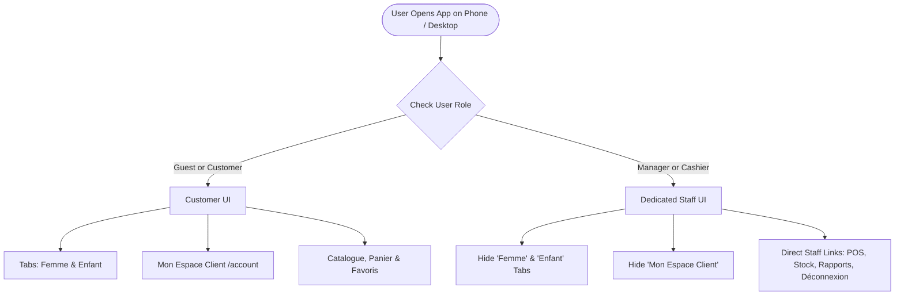

# Plan & Checklist — Staff Interface Simplification (Mobile & Desktop)

> **Status**: 📋 **PLAN MODE ONLY — Awaiting User Approval (Do NOT implement yet)**  
> **Target Project**: Top Tendance (Next.js 14 App Router, Supabase, Tailwind CSS)  
> **Date**: 2026-11-14  

---

## 📌 Executive Summary

Top Tendance operates as both an e-commerce shop for Tunisian customers and an in-store management platform for store staff (Manager & Cashier). On mobile smartphones:

1. **Staff Roles (`manager` & `cashier`)** access the app on phones/tablets for work: POS Register, Stock management, Deliveries, and Reports.
2. **Current Issue**:
   - The navigation header dropdown and mobile drawer display **"Mon Espace Client"** (order history, personal customer addresses, personal wishlist) even when logged in as a Manager or Cashier.
   - The mobile drawer tabs prominently feature **"Femme"** and **"Enfant"** categories, which are intended for online shopping customers, cluttering the mobile workspace for staff members.
3. **Requirement**:
   - For **Manager** and **Cashier**:
     - ❌ **Hide "Mon Espace Client"** from account menus and navigation.
     - ❌ **Hide "Femme" and "Enfant"** shopping categories / tabs on phone/mobile menus (and optionally desktop nav if logged in as staff).
     - ✅ **Display pure Staff Hub / Navigation**: Quick access to **Caisse POS**, **Gestion Stock**, **Carnet de Crédit**, **Colis & Livraisons**, and **Rapports**, plus Account Profile & Déconnexion.
   - For **Customers (`customer` or unauthenticated guests)**:
     - ✅ Retain full customer experience: **Femme**, **Enfant**, **Mon Espace Client**, Panier, and Favoris.

---

## 🎯 Navigation Experience Matrix

| Navigation Element | Non-Connecté (Guest) | Client Connecté | Caissier (`cashier`) | Responsable (`manager`) |
|---|---|---|---|---|
| **Tabs Catégories "Femme" & "Enfant"** (Mobile Drawer) | ✅ Visible | ✅ Visible | 🚫 **Hidden** (Replaced by Staff menu) | 🚫 **Hidden** (Replaced by Staff menu) |
| **Lien "Femme" & "Enfant"** (Desktop Header) | ✅ Visible | ✅ Visible | 🚫 **Hidden or Staff Mode** | 🚫 **Hidden or Staff Mode** |
| **"Mon Espace Client"** (Header Dropdown & Account) | 🚫 (Shows Se Connecter) | ✅ Visible (`/account`) | 🚫 **Hidden** | 🚫 **Hidden** |
| **Caisse Enregistreuse POS (`/pos`)** | 🚫 (Or shortcut link) | 🚫 Hidden | ✅ **Primary Action** | ✅ **Primary Action** |
| **Gestion Stock & Boutique (`/inventory`)** | 🚫 Hidden | 🚫 Hidden | ✅ Visible (Restricted) | ✅ Visible (Full) |
| **Rapports & Ventes (`/reports`)** | 🚫 Hidden | 🚫 Hidden | ✅ Visible | ✅ Visible |
| **Carnet de Crédit & Livraisons Shortcuts** | 🚫 Hidden | 🚫 Hidden | ✅ Visible | ✅ Visible |
| **Bouton Se Déconnecter** | 🚫 | ✅ Visible | ✅ Visible | ✅ Visible |

---

## 🏗️ Architecture & Component Impact



---

## 📋 Comprehensive Implementation Checklist

### 1. Mobile Menu (`src/components/common/MobileMenu.tsx`)
- [x] **Staff Detection**:
  - [x] Define helper boolean `const isStaff = userProfile?.role === 'manager' || userProfile?.role === 'cashier';`
- [x] **Conditional Category Tabs (Femme & Enfant)**:
  - [x] Wrap the `activeTab === 'women'` / `activeTab === 'kids'` header switcher inside `{!isStaff && (...)}`.
  - [x] Wrap the category links (Robes, Ensembles, Bebe, etc.) inside `{!isStaff && (...)}`.
- [x] **Staff-Centric Mobile Drawer Content**:
  - [x] When `isStaff` is true, render a streamlined staff workspace menu:
    - [x] Staff badge: Role icon (`👑 Responsable Boutique` or `💼 Caissier`) + Name.
    - [x] Quick Link: **Caisse Enregistreuse POS** (`/pos`) with prominent action button.
    - [x] Quick Link: **Gestion Stock & Boutique** (`/inventory`).
    - [x] Quick Link: **Rapports & Ventes** (`/reports`).
    - [x] Quick Link: **Carnet de Crédit** (`/inventory?tab=credit`).
    - [x] Quick Link: **Colis & Expéditions** (`/inventory?tab=shipping`).
  - [x] Hide customer-facing shortcuts in staff view (e.g., "Mes Favoris", "Boutique en ligne" shopping categories).
- [x] **Logout & Account Details**:
  - [x] Ensure **"Mon Espace Client"** is NOT shown for staff.
  - [x] Keep clear **"Se déconnecter"** button with confirmation or instant sign-out.

---

### 2. Header Dropdown Menu (`src/components/common/Header.tsx`)
- [x] **Account Dropdown (`/account` link)**:
  - [x] Check lines `243-249`:
    ```tsx
    {/* Only show Mon Espace Client for real customers */}
    {userProfile?.role !== 'cashier' && userProfile?.role !== 'manager' && (
      <Link href="/account" onClick={() => setIsAccountMenuOpen(false)}>
        <User size={14} /> Mon Espace Client
      </Link>
    )}
    ```
- [x] **Header Desktop Navigation (Femme / Enfant)**:
  - [x] For staff logged in on desktop/tablet, conditionally hide "Femme" and "Enfant" catalog links or replace with direct staff links (**POS**, **Stock**, **Rapports**).
- [x] **Direct Redirection Safeguard**:
  - [x] If a cashier or manager manually browses to `/account`, display a staff-friendly banner or redirect them to `/pos` or `/inventory`.

---

### 3. Route Guard & User Experience Check (`src/app/account/page.tsx`)
- [x] Verify `/account`:
  - [x] When `userProfile?.role === 'manager' || userProfile?.role === 'cashier'`, provide a clear quick-switch card or automatic redirect to `/pos` so staff aren't confused by personal customer order history.

---

### 4. Verification & Testing Plan
- [ ] **Mobile Testing (Phone Viewports: iPhone, Android, Responsive 375px-430px)**:
  - [ ] Log in as **Manager**: Check Mobile drawer — confirm "Femme" & "Enfant" tabs are gone, "Mon Espace Client" is gone, and POS/Stock/Rapports are immediately accessible.
  - [ ] Log in as **Cashier**: Check Mobile drawer — confirm no customer categories/account, clean cashier navigation is shown.
  - [ ] Log in as **Customer**: Check Mobile drawer — confirm "Femme", "Enfant", and "Mon Espace Client" remain intact and normal.
  - [ ] Non-logged-in Guest: Confirm full public catalog browsing is intact.
- [ ] **Desktop & Tablet Testing**:
  - [ ] Verify Header user dropdown for Manager and Cashier has no "Mon Espace Client" link.
- [ ] **Build Validation**:
  - [ ] Run `npm run build` to verify zero TypeScript errors and zero layout breakages.

---

> **Awaiting Approval**: Please review this checklist. Once you approve, we will proceed with the code changes.
